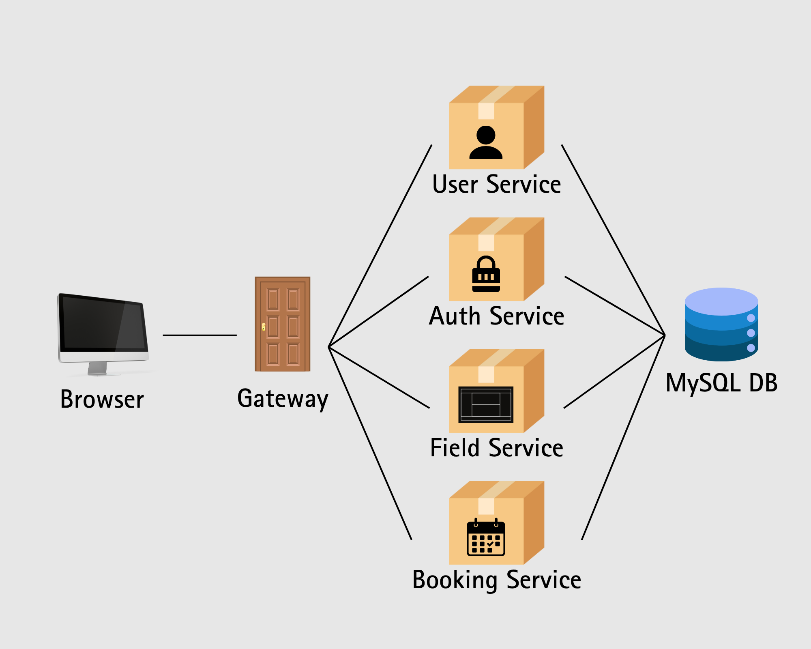

# PadelPop 🎾

<p align="center">
  <strong>Main Padel cantik di lapangan estetik. Bookingnya di #PadelPop aja 😎</strong>
</p>

<p align="center">
  A web application for booking padel courts online, with secure authentication, real-time availability and an admin dashboard.
</p>

<p align="center">
  
  
  
  
  
  
  
</p>

<p align="center">
  <a href="#demo">Demo</a> •
  <a href="#features">Features</a> •
  <a href="#tech-stack">Tech Stack</a> •
  <a href="#architecture">Architecture</a> •
  <a href="#api-reference">API</a> •
  <a href="#getting-started">Getting Started</a> •
  <a href="#team">Team</a>
</p>

---

## What is PadelPop?

**PadelPop** is a court reservation system for padel. Players can browse courts, check which dates and hours are still free, and book a slot in a few clicks. Admins manage courts, bookings and user accounts from a dedicated dashboard.

It was built as a **group course project** to practise designing a secured REST API with JWT, Google OAuth, rate limiting, an API gateway, HTTPS and Docker.

```text
Register / Login → Browse Courts → Pick Date & Time → Book → Manage Reservations
```

---

## Demo

> Browse courts, book a time slot, and manage your reservations.

**Live demo:** <!-- TODO: add the deployed URL here once the app is online -->

<!-- TODO: add screenshots to docs/screenshots/, then uncomment the table below.
<table>
  <tr>
    <td align="center" width="20%">
      <br />
      <sub><strong>Login</strong></sub>
    </td>
    <td align="center" width="20%">
      <br />
      <sub><strong>Courts</strong></sub>
    </td>
    <td align="center" width="20%">
      <br />
      <sub><strong>Booking</strong></sub>
    </td>
    <td align="center" width="20%">
      <br />
      <sub><strong>My Reservations</strong></sub>
    </td>
    <td align="center" width="20%">
      <br />
      <sub><strong>Admin Dashboard</strong></sub>
    </td>
  </tr>
</table>
-->

---

## Features

| Feature                | Description                                                              |
| ---------------------- | ------------------------------------------------------------------------ |
| Authentication         | Log in with email and password, or with a Google account                 |
| Registration           | Create an account with name, email and password                          |
| Real-time Availability | See courts with their location and free dates and hours, straight from the database |
| Booking                | Reserve a court and avoid double bookings                                |
| Reservation Management | View and manage your bookings on the "Reservasi Saya" page              |
| Admin Dashboard        | Manage courts, bookings and user accounts                                |
| Security               | Encrypted passwords, JWT-based sessions, API rate limiting and HTTPS     |

---

## Tech Stack

| Technology                 | Function             |
| -------------------------- | -------------------- |
| HTML + JavaScript          | Frontend             |
| Node.js                    | Backend              |
| Express.js                 | API framework        |
| MySQL                      | Database             |
| jsonwebtoken               | Authentication token |
| Passport.js + Google OAuth | Login with Google    |
| express-rate-limit         | Rate limiting        |
| Swagger                    | API documentation    |
| Docker                     | Containerization     |

---

## Architecture



| Service  | Base path        | Responsibility                                                  |
| -------- | ---------------- | --------------------------------------------------------------- |
| Auth     | `/api/auth`      | Registration, login and Google OAuth                            |
| Fields   | `/api/fields`    | Court data: name, location and price per hour                   |
| Bookings | `/api/bookings`  | Create, view and cancel bookings, and prevent double orders     |
| Users    | `/api/users`     | Account management (admin only)                                 |
| Frontend | `public/`        | Pages for login, register, courts, booking, history and admin   |
| Database | MySQL            | Stores all application data                                     |

### Repository Structure

<!-- TODO: verify the one-line descriptions against the actual code -->

```text
PadelPop/
├── config/                  # Application configuration
├── controllers/             # Request handlers
├── gateway/                 # API gateway
├── middlewares/             # Express middlewares
├── models/                  # Database models
├── public/                  # Frontend (HTML + JavaScript)
├── routes/                  # API routes
├── app.js                   # Express app
├── server.js                # Server entry point
├── padel_reservation.sql    # Database schema
├── Dockerfile
├── docker-compose.yml
├── .env.example             # Template for environment variables
└── arsitektur.png           # Architecture diagram
```

---

## API Reference

<!-- TODO: double-check access levels against the files in routes/ -->

### Authentication (`/api/auth`)

| Method | Endpoint           | Description                    | Access |
| ------ | ------------------ | ------------------------------ | ------ |
| POST   | `/register`        | Register a new user            | Public |
| POST   | `/login`           | Log in                         | Public |
| GET    | `/google`          | Start Google login             | Public |
| GET    | `/google/callback` | Google OAuth callback          | Public |

### Fields (`/api/fields`)

| Method | Endpoint | Description              | Access    |
| ------ | -------- | ------------------------ | --------- |
| GET    | `/`      | List all courts          | All users |
| GET    | `/:id`   | Get a court by id        | All users |
| POST   | `/`      | Add a court              | Admin     |
| PUT    | `/:id`   | Update a court           | Admin     |
| DELETE | `/:id`   | Delete a court           | Admin     |

### Bookings (`/api/bookings`)

| Method | Endpoint  | Description                    | Access |
| ------ | --------- | ------------------------------ | ------ |
| GET    | `/my`     | List my bookings               | User   |
| POST   | `/`       | Create a booking               | User   |
| DELETE | `/:id`    | Delete a booking               | User   |
| GET    | `/`       | List all bookings              | Admin  |
| GET    | `/:id`    | Get a booking by id            | Admin  |
| POST   | `/admin`  | Create a booking for any user  | Admin  |
| PUT    | `/:id`    | Update a booking               | Admin  |
| DELETE | `/:id`    | Delete any booking             | Admin  |

### Users (`/api/users`)

| Method | Endpoint | Description              | Access |
| ------ | -------- | ------------------------ | ------ |
| GET    | `/`      | List all accounts        | Admin  |
| POST   | `/`      | Create an account        | Admin  |
| PUT    | `/:id`   | Update an account        | Admin  |
| DELETE | `/:id`   | Delete an account        | Admin  |

---

## Project Requirements

| Requirement                                                        | Status |
| ------------------------------------------------------------------ | :----: |
| REST API with CRUD, data stored in a relational database           |   ✅   |
| JWT for user authentication                                        |   ✅   |
| Google OAuth login                                                 |   ✅   |
| Rate limiting per user                                             |   ✅   |
| API gateway for routing and validation                             |   ✅   |
| Services packaged with Docker                                      |   ✅   |
| HTTPS with SSL/TLS certificate                                     |   ✅   |
| Encryption of sensitive data on the server                         |   ✅   |
| IoT integration (optional)                                         |   ❌   |
| IoT data through a message broker (RabbitMQ / Kafka)               |   ❌   |
| Kubernetes orchestration                                           |   ❌   |

---

## Getting Started

### Prerequisites

- [Node.js](https://nodejs.org/) and npm
- MySQL (or XAMPP / Laragon)
- OpenSSL (included in Git for Windows via Git Bash)

### Run locally

```bash
# 1. Clone and install
git clone https://github.com/daffmaulana/PadelPop.git
cd PadelPop
npm install

# 2. Create the database and import the schema
mysql -u root -p -e "CREATE DATABASE padel_reservation"
mysql -u root -p padel_reservation < padel_reservation.sql

# 3. Create your environment file, then edit it with your own values
cp .env.example .env

# 4. Generate a local HTTPS certificate (self-signed, for development only)
mkdir -p cert
openssl req -x509 -newkey rsa:2048 -nodes -days 365 \
  -keyout cert/key.pem -out cert/cert.pem -subj "/CN=localhost"

# 5. Start the server
node server.js
```

Then open <https://localhost:3001>. Your browser will warn about the self-signed certificate; this is expected in development.

<!-- TODO: use the exact certificate file names that server.js expects -->

> The `cert/` folder and the `.env` file are intentionally **not** in the repository. Never commit private keys or secrets.

### Environment variables

| Variable               | Description                          |
| ---------------------- | ------------------------------------ |
| `PORT`                 | HTTP port (default `3000`)           |
| `PORTS`                | HTTPS port (default `3001`)          |
| `DB_HOST`              | Database host                        |
| `DB_USER`              | Database user                        |
| `DB_PASSWORD`          | Database password                    |
| `DB_NAME`              | Database name (`padel_reservation`)  |
| `JWT_SECRET`           | Secret used to sign tokens (32+ characters) |
| `GOOGLE_CLIENT_ID`     | Google OAuth client id               |
| `GOOGLE_CLIENT_SECRET` | Google OAuth client secret           |

Create your own Google credentials in the [Google Cloud Console](https://console.cloud.google.com/apis/credentials).

### Optional: run with Docker

```bash
# Use DB_HOST=db and DB_PASSWORD=root in your .env
docker-compose up --build
```

Then open Adminer at `localhost:8080` (user `root`, password `root`), import `padel_reservation.sql`, restart the `padel_reservation_app` container and open <https://localhost:3001>.

---

## Roadmap

- [ ] Deploy the application and add the live demo link
- [ ] Add screenshots to the README
- [ ] Add automated tests and a CI workflow
- [ ] Integrate IoT data through a message broker
- [ ] Orchestrate the services with Kubernetes

---

## Team

Built by a group of six:

- Daffa Bagus Maulana
- Putra Mahandika
- Ananda Divana
- Dafa Andika Firmansyah
- Farel Bayhaqi
- Faiz Firstian Nugroho

<!-- TODO: describe your own contribution to the project (e.g. which services or pages you built) -->

---

<p align="center">
  <strong>PadelPop</strong><br>
  Book your court. Play in style.
</p>
